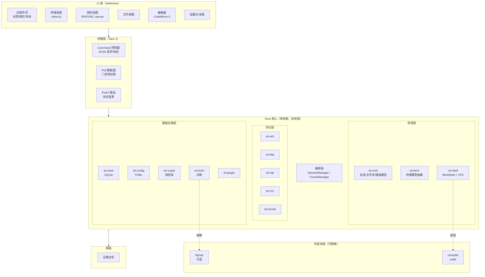
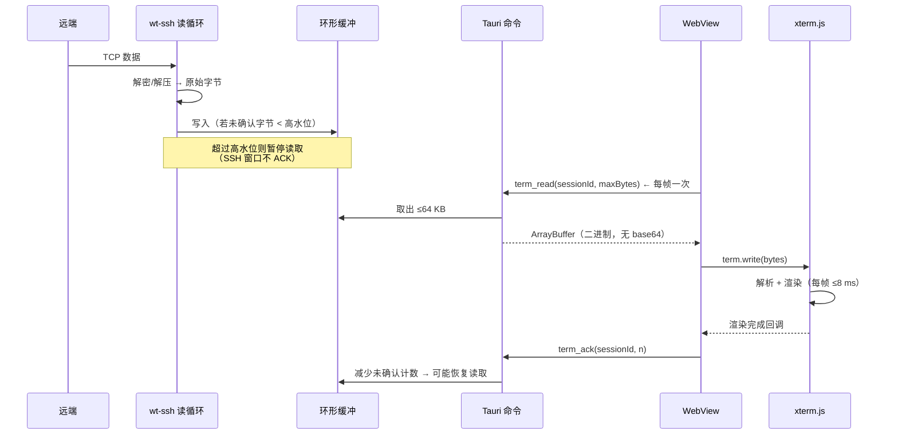

# 详细设计 · 01 · 总体架构

实现需求：`SES-*` `TER-*` `FIL-*` `GUI-*` `NET-*` `LOC-*` `SEC-*` `SET-*` `EXT-*` `SYS-*` 的架构承载
关键 `NFR`：`NFR-001` `NFR-002` `NFR-003` `NFR-017`

## 1. 设计约束

架构不是自由选择的结果，而是被四条约束挤压出来的形状：

| 约束 | 来源 | 对架构的影响 |
|---|---|---|
| **C1 必须跨三平台** | `spec/01` §2.4 支点一 | 不能用 Win32/Qt 作为主 UI 框架；不能用平台专有 API 作为核心依赖 |
| **C2 必须能跑高吞吐终端** | `NFR-003` | 终端数据通路不能经过 JSON 序列化；必须有背压 |
| **C3 高风险能力必须可替换** | `spec/01` §1.3、ADR-0007 | 抓包驱动、POSIX 环境必须是 provider 而非内建 |
| **C4 必须可审计** | `spec/01` §2.4 支点三 | 凭据、网络、外部进程三条路径必须收口到少数几个模块 |

这四条约束直接排除了两个看似合理的选择：

- **纯 Electron**：C1 满足，但 C2 在 IPC 与内存上先天吃亏（且包体 100 MB+ 与「轻量替代」定位冲突）。
- **纯 Rust GUI（egui/iced）**：C2 很好，但 C1 上终端渲染、富文本编辑、i18n 排版都要自研，M1 交付不了。

**结论**：WebView 做 UI + Rust 做一切非 UI 的事。这就是 Tauri 2 的形状。

## 2. 总体架构



### 2.1 为什么是「单进程 + 多线程」而不是多进程

| 方案 | 优点 | 缺点 | 结论 |
|---|---|---|---|
| 单进程多线程 | 无 IPC 序列化开销、共享内存天然可用、调试简单 | 一个 crate panic 可能拖垮全局 | ✅ 采用，但用 `catch_unwind` 隔离会话任务 |
| 每会话一个子进程 | 隔离性好 | 50 会话 = 50 进程，内存与调度成本高；IPC 又要序列化 | ❌ |
| 核心进程 + UI 进程 | 崩溃隔离 | Tauri 已经把 WebView 放在独立进程，核心崩溃仍会带走全部会话 | ❌ 收益不足 |

**崩溃隔离的实际做法**：每个会话的读循环跑在独立 `tokio::task` 中，panic 被 `JoinHandle` 捕获，只终止该会话并向 UI 报告，不影响其他会话。这是「够用的隔离」，成本远低于多进程。

> 注意：Rust 的 panic 默认 `unwind`，可以用 `catch_unwind` 恢复；但 `panic = "abort"` 会失去这个能力。发布构建**不使用** `panic = "abort"`——这是为隔离性付出的体积代价（约 3~5%）。

## 3. Crate 划分

```
windterm/
├── Cargo.toml                  # workspace
├── apps/
│   ├── wt-desktop/             # Tauri 应用入口（bin）
│   └── wt-cli/                 # CLI 入口（bin）
├── crates/
│   ├── wt-common/              # 错误类型、日志、平台抽象、工具函数
│   ├── wt-core/                # 领域模型（无 IO）：Session/Folder/Tunnel/Macro
│   ├── wt-config/              # 配置加载、校验、迁移
│   ├── wt-store/               # SQLite 持久化、迁移脚本
│   ├── wt-crypto/              # Argon2id、XChaCha20-Poly1305、保险库、密钥解析
│   ├── wt-term/                # TerminalBackend trait + 屏幕模型（为 v2 预留）
│   ├── wt-ssh/                 # SSH 协议栈（封装 russh）+ 主机密钥 + agent
│   ├── wt-sftp/                # SFTP 客户端 + 传输引擎 + SCP
│   ├── wt-rdp/                 # RDP（封装 IronRDP）
│   ├── wt-vnc/                 # RFB 客户端
│   ├── wt-tunnel/              # 端口转发（-L/-R/-D）
│   ├── wt-shell/               # WindShell、路径命名空间、内建命令
│   ├── wt-tools/               # ping/traceroute/dns/tls/端口探测/抓包
│   ├── wt-plugin/              # 插件宿主、manifest、WASM 运行时
│   ├── wt-ipc/                 # IPC 协议类型与编解码（Rust + TS 共享定义）
│   └── wt-bench/               # 性能基准（供 wt bench 使用）
└── ui/                         # 前端工程（SolidJS + TS + Vite）
```

### 3.1 分层规则（CI 强制）

```
apps/*  ──依赖──►  crates/*
                     │
   ┌─────────────────┼──────────────────┐
   ▼                 ▼                  ▼
协议层            领域层            基础设施层
wt-ssh/sftp        wt-core           wt-store/config
wt-rdp/vnc         wt-term           wt-crypto
wt-tunnel          wt-shell          wt-tools/plugin
   │                 │                  │
   └────────┬────────┴──────────────────┘
            ▼
        wt-common
```

| 规则 | 说明 |
|---|---|
| **禁止反向依赖** | `wt-common` 不得依赖任何其他 crate；`wt-core` 不得依赖 `wt-store` |
| **禁止环** | 用拓扑排序检查（`NFR-017`） |
| **协议层互不依赖** | `wt-ssh` 不知道 `wt-rdp` 存在；跳板机通过 `wt-tunnel` 的抽象组合 |
| **`wt-core` 无 IO** | 不引入 `tokio`、不读文件、不连网络——保证领域逻辑可纯函数测试 |
| **UI 不直接依赖协议层** | 前端只通过 `wt-ipc` 的类型与命令交互 |

**`wt-core` 无 IO 是硬约束**，它的价值在测试：会话树操作、导入映射、路径解析、宏解析全部可以毫秒级跑几千条用例。一旦引入 IO，这些测试会变成需要 mock 的集成测试。

### 3.2 依赖方向的一个具体例子

「经跳板机连 RDP」这条链路，谁依赖谁？

```
wt-rdp  ──需要一个「已建立的 TCP 流」──►  wt-tunnel 的 StreamProvider trait
                                              ▲
                                              │ 实现
                                         wt-ssh（direct-tcpip）
```

`wt-rdp` 只依赖一个 trait（`fn connect(&self, host, port) -> Box<dyn AsyncRead+Write>`），不依赖 `wt-ssh`。
这样「经代理连 RDP」「经多跳连 RDP」都是同一个 trait 的不同实现，RDP 代码零改动。

这个模式在本项目中反复出现，是本架构最重要的复用点：

| trait | 位置 | 实现者 |
|---|---|---|
| `StreamProvider` | `wt-core` | `wt-ssh`（direct-tcpip）、`wt-tunnel`（本地监听）、直连 |
| `TerminalBackend` | `wt-term` | xterm.js 桥（v1）、Rust 内核（v2） |
| `CredentialSource` | `wt-core` | 保险库 / agent / 交互提示 |
| `FileSystem` | `wt-core` | 本地 / SFTP / FTP |

## 4. 技术选型

| 领域 | 选择 | 版本 | 理由 | 备选 | ADR |
|---|---|---|---|---|---|
| 应用框架 | Tauri 2 | 2.x | 小包体、原生能力、Rust 后端 | Wails、Electron | ADR-0001 |
| 前端框架 | SolidJS | 1.9+ | 细粒度响应式、无 VDOM、运行时 ~7 KB | Svelte 5、React | ADR-0008 |
| 语言（前端） | TypeScript | 5.x | | | |
| 构建（前端） | Vite | 6.x | | | |
| 终端 | `@xterm/xterm` | 5.x | conformance 成熟 | 自研 Rust 内核 | ADR-0004 |
| 编辑器 | CodeMirror 6 | 6.x | 体积小（~300 KB）、可扩展 | Monaco（~5 MB） | — |
| 异步运行时 | tokio | 1.x | 生态标准 | async-std | — |
| SSH | `russh` | 0.4x | 纯 Rust、支持 direct-tcpip/forwarding | `ssh2`（libssh2） | ADR-0005 关联 |
| RDP | `IronRDP` | 0.6+ | 纯 Rust、NLA/EGFX/CLIPRDR/RDPDR | FreeRDP 绑定 | — |
| VNC | 自研 `wt-vnc` | — | RFB 简单，自研可控（~2000 行） | `vnc-rs` | — |
| SQLite | `rusqlite`（bundled） | 0.3x | 无系统依赖 | `sqlx` | ADR-0006 |
| 序列化 | `serde` + `serde_json` + `toml` | | | | |
| 加密 | `argon2` + `chacha20poly1305` | | 见 `design/09` | | ADR-0009 |
| 日志 | `tracing` + `tracing-subscriber` | | 结构化、span | | |
| WASM | `wasmtime` | | 沙箱脚本 | `wasmer` | — |
| HTTP 服务端 | `axum` | 0.7+ | 内置 HTTP 服务 | `hyper` 裸用 | — |
| 串口 | `serialport` | 4.x | 跨平台 | | — |
| 图像 | `image` | 0.25 | 图片查看 | | — |
| 单实例 | `interprocess` 或自研命名管道 | | | | |

### 4.1 关于 russh 的能力边界

`russh` 需要覆盖的能力是：`direct-tcpip`（跳板机）、`tcpip-forward`（`-R` 远程转发）、`subsystem sftp`、`keepalive@openssh.com`、agent 转发、以及 `keyboard-interactive`。

**不再需要 `x11-req` / `x11` 通道**——X11 能力已整体移除（ADR-0012）。这同时消掉了本设计此前最大的一处技术不确定性：原先「若 russh 不支持 X11 就换 `ssh2`」的备选路径不再需要，协议栈选型的风险随之下降。

**架构上的保障（仍然有效）**：`wt-ssh` 对外暴露的是 `SshSession` trait，不暴露 `russh` 类型。若将来 `russh` 在某个能力上有缺口，换实现不影响任何上层代码。这是「协议层封装」这条规则的实际收益。

## 5. 关键数据流

### 5.1 终端数据（最高频路径）



**关键设计点**

| 点 | 为什么 |
|---|---|
| 拉取而非推送 | 天然背压：前端不请求就不会有数据堆积；不需要限流逻辑 |
| 二进制而非 JSON | 避免 base64（+33%）与 JSON 转义开销；实测差距在 3~5 倍 |
| 每帧一次拉取 | 与 `requestAnimationFrame` 对齐，避免 IPC 风暴 |
| 环形缓冲在 Rust | 前端卡死/崩溃时数据不丢；日志、搜索、跟随路径都从这里取 |

详见 `design/02` §5。

### 5.2 RDP 画面

```
IronRDP 解码线程 → RGBA 帧 → 脏矩形合并 → 双缓冲
                                    │
        WebView: rdp_frame(sessionId) ← 拉取
                 → ImageData → canvas.putImageData（仅脏区）
```

**不做**：不做视频编码（H.264 在客户端解码后是裸 RGBA，再编码一次纯属浪费）。带宽问题在协议层（EGFX）解决。

### 5.3 文件传输

```
UI 发起 → wt-sftp 传输任务 → tokio 任务池（并发 N）
                              → 进度事件（每 500 ms 节流）→ UI
                              → 完成/失败事件
```

**进度事件节流是必须的**：1000 个小文件如果每个都发事件，前端会被事件淹没。

## 6. 错误处理

### 6.1 错误类型

```rust
// wt-common/src/error.rs
pub struct WtError {
    pub kind: ErrorKind,        // 分类（用于 UI 决策）
    pub code: &'static str,     // 稳定错误码（用于文档与测试）
    pub message: String,        // 面向用户的一句话（已本地化）
    pub detail: Option<String>, // 技术细节（折叠显示）
    pub hints: Vec<Hint>,       // 可执行的建议（按钮）
    pub source: Option<Box<dyn Error>>,
}

pub enum ErrorKind {
    Config, Network, Auth, Protocol, Permission,
    NotFound, Conflict, Resource, Internal, Canceled,
}

pub struct Hint {
    pub label: String,          // "改用随机端口"
    pub action: HintAction,     // 结构化动作，前端可执行
}
```

**三条硬规则**

1. **每个错误有稳定 `code`**（如 `SSH_HOSTKEY_CHANGED`、`TUNNEL_PORT_IN_USE`）。文档与测试引用 code，不引用文案。
2. **`message` 必须是用户能懂的一句话**，不能是协议原文。协议原文放 `detail`。
3. **能给出动作就必须给**（`hints` 非空）。「连接失败」+ 无建议 = 不合格。

### 6.2 错误码分段

| 段 | 范围 | 示例 |
|---|---|---|
| `CFG_` | 配置 | `CFG_INVALID_TOML` |
| `STORE_` | 存储 | `STORE_MIGRATION_FAILED` |
| `CRY_` | 加密/凭据 | `CRY_VAULT_CORRUPT` |
| `SSH_` | SSH | `SSH_HOSTKEY_CHANGED` `SSH_NO_COMMON_KEX` |
| `SFTP_` | 文件传输 | `SFTP_NO_SPACE` |
| `RDP_` | RDP | `RDP_NLA_REQUIRED` |
| `VNC_` | VNC | `VNC_NO_COMMON_ENCODING` |
| `VNC_` | VNC | `VNC_NO_COMMON_ENCODING` `VNC_AUTH_FAILED` |
| `TUN_` | 隧道 | `TUN_PORT_IN_USE` `TUN_FORWARD_DENIED` |
| `SHE_` | 本地 Shell | `SHE_UNSUPPORTED_SYNTAX` |
| `PLG_` | 插件 | `PLG_SIG_INVALID` |
| `SYS_` | 系统 | `SYS_WEBVIEW_MISSING` |

### 6.3 错误传播

```rust
// 领域层用具体错误，边界层转 WtError
impl From<SshError> for WtError { ... }

// 命令层统一返回
#[tauri::command]
async fn connect(...) -> Result<ConnectResult, WtError> { ... }
```

**禁止**：`unwrap()` / `expect()` 出现在非测试代码。CI 用 `clippy::unwrap_used` 检查（`allow` 需注释理由）。

## 7. 性能预算

| 路径 | 预算 | 分配 |
|---|---|---|
| 启动（`NFR-001`） | 1200 ms | 见 `spec/13` §2 |
| 终端 IPC 单次往返 | ≤ 1 ms | 命令分发 0.2 ms + 缓冲拷贝 0.3 ms + 序列化 0.1 ms + 余量 |
| 终端渲染一帧 | ≤ 8 ms | 解析 3 ms + 绘制 4 ms + 余量 |
| RDP 解码 1080p 帧 | ≤ 15 ms | EGFX 解码 10 ms + 合成 5 ms |
| SFTP 单块（128 KB） | ≤ 3 ms | 加密 0.5 ms + 网络往返（不计） |
| 会话树渲染 500 项 | ≤ 50 ms | 虚拟列表 |

**预算超标处理**：内置性能面板（`NFR-021`）显示各路径实测值；CI 基准超标即失败。

## 8. 目录与文件布局

```
<config-dir>/
├── config.toml
├── data.db
├── data.db.bak
├── vault.bin
├── vault.bin.bak
├── known_hosts
├── policy.json            # 可选
├── audit/
│   └── 2026-11.jsonl
├── logs/
│   └── windterm.log
├── plugins/
│   └── <name>/
├── backup/
│   └── 1.2.0/
└── tmp/                   # 临时下载、编辑缓冲
```

`<cache-dir>/`：缩略图、图片缓存、更新包下载。

**临时文件清理**：启动时清理 7 天前的 `tmp/` 内容；正常退出时清理本次会话的临时文件。

## 9. 非目标（架构层面）

| 不做 | 理由 |
|---|---|
| 微服务化 / 多进程拆分 | 单机桌面应用，拆分只增加成本 |
| 自研 WebView | 不可能，也无必要 |
| 自研 SSH/RDP 加密原语 | 用经过审计的 crate，不自研密码学 |
| 插件运行在独立进程 | 进程隔离对「用户主动安装的本地工具」没有意义（它能做任何事）；WASM 才需要沙箱 |
| 支持 32 位平台 | 目标用户与依赖库都不需要 |

## 10. 与需求的对应

| 架构决策 | 承接需求 | 相关 ADR |
|---|---|---|
| Tauri 2 + Rust 核心 | 全部 | ADR-0001 |
| 单进程多线程 + task 级 panic 隔离 | `NFR-007` | — |
| `StreamProvider` 抽象 | `SES-024/025/026`、`GUI-015` | — |
| `TerminalBackend` 抽象 | `TER-*`、`NFR-003` | ADR-0004 |
| X11 能力整体移除 | `GUI-001`~`GUI-014`（作废）、`SES-007`（作废） | ADR-0012 |
| 拉取式二进制 IPC | `NFR-003` | ADR-0005 |
| SQLite + TOML 分离 | `SET-006`、`SES-012` | ADR-0006 |
| 错误码体系 | 全部（可解释失败） | — |
| crate 分层与禁止环 | `NFR-017` | — |
