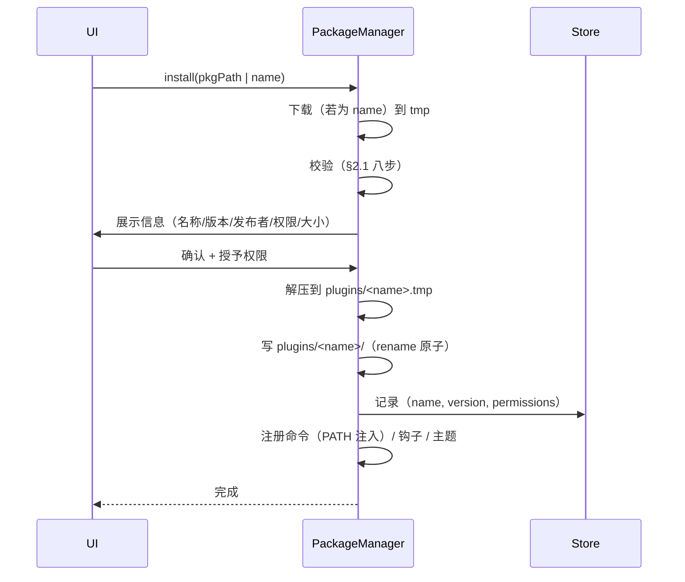

# 详细设计 · 12 · 插件与包管理

实现需求：`EXT-001`~`EXT-008`、`LOC-023`
关键约束：`SEC-014`（供应链）、`SEC-009`（企业策略）

## 1. 三种扩展形态

| 形态 | 能力 | 隔离 | 适用 |
|---|---|---|---|
| **进程插件** | 任意（就是启动一个程序） | 无（等同用户本人） | 内部工具、CLI 封装 |
| **WASM 脚本** | 受限（按权限授予） | 强（沙箱） | 钩子、格式化、轻逻辑 |
| **数据插件** | 无代码（主题、语法规则、宏） | 不适用 | 主题、高亮规则集 |

**必须向用户讲清这个区别**：安装进程插件时提示「此插件以你的身份运行程序，权限等同于你本人」；WASM 插件则显示「沙箱运行，仅能访问已授权资源」。

## 2. 包格式

```
acme-tools-1.2.0.wtpkg  (zip)
├── manifest.json
├── signature.ed25519          # 对 manifest.json 的签名
├── payload/
│   ├── bin/acme-check.exe
│   ├── share/themes/acme-dark.json
│   └── scripts/on-connect.wasm
└── LICENSE
```

### 2.1 manifest 校验

```rust
#[derive(Deserialize)]
pub struct Manifest {
    pub name: String,                       // ^[a-z][a-z0-9-]{1,63}$
    pub display_name: String,
    pub version: String,                    // semver
    pub publisher: String,
    pub description: Option<String>,
    pub license: Option<String>,
    pub homepage: Option<String>,
    pub windterm: VersionRange,             // minVersion / maxVersion
    pub platforms: Vec<Platform>,
    pub provides: Provides,
    pub permissions: Vec<Permission>,
    pub checksums: HashMap<String, String>, // path -> "sha256:..."
}
```

**校验顺序**

```
1. zip 结构合法（无路径穿越：条目名不含 .. 或绝对路径）
2. manifest.json 存在且能解析
3. signature.ed25519 对 manifest.json 原始字节的签名有效
4. manifest.name/version 与文件名一致
5. windterm.minVersion ≤ 当前版本 ≤ maxVersion
6. 当前平台在 platforms 中
7. 每个 payload 文件的 sha256 与 checksums 一致
8. permissions 都是已知的（未知权限 → 拒绝）
```

**第 1 步（zip 路径穿越）必须做**：zip 条目名可以是 `../../etc/passwd`，解压时会写到预期目录之外。这是经典的 Zip Slip 漏洞。

```rust
fn safe_extract(zip: &mut ZipArchive<File>, dest: &Path) -> Result<()> {
    for i in 0..zip.len() {
        let mut entry = zip.by_index(i)?;
        let name = entry.name();
        if name.contains("..") || name.starts_with('/') || name.contains(':') {
            return Err(WtError::new("PLG_UNSAFE_PATH").message(format!("包内路径非法：{name}")));
        }
        let out = dest.join(name);
        if !out.starts_with(dest) {
            return Err(WtError::new("PLG_UNSAFE_PATH"));
        }
        // 符号链接也拒绝（zip 可以包含 symlink）
        if entry.unix_mode().map(|m| m & 0o170000 == 0o120000).unwrap_or(false) {
            return Err(WtError::new("PLG_SYMLINK_REFUSED"));
        }
        entry.unpack(&out)?;
    }
    Ok(())
}
```

### 2.2 签名

```rust
pub fn verify_manifest(manifest_bytes: &[u8], sig: &[u8], trusted: &[VerifyingKey]) -> Result<()> {
    for key in trusted {
        if key.verify(manifest_bytes, &Signature::from_slice(sig)?).is_ok() {
            return Ok(());
        }
    }
    Err(WtError::new("PLG_SIG_INVALID")
        .message("插件签名无效，可能被篡改")
        .detail("签名与任何受信任的发布者公钥都不匹配"))
}
```

**信任公钥来源**

| 来源 | 说明 |
|---|---|
| 内置 | 官方发布者（编译进二进制） |
| 策略文件 | 企业发布者（`SEC-009` 的 `allowedPluginPublishers`） |
| 用户手动添加 | 设置页「信任的发布者」，需确认指纹 |

**策略联动**：`allowPluginInstall = false` 时拒绝一切安装；`allowedPluginPublishers` 非空时只允许列表内的发布者。

## 3. 安装流程



**原子性**：解压到 `.tmp` 目录，全部成功后 `rename` 为最终目录。失败时删除 `.tmp`。

**升级**：先装到 `.new`，成功后把旧的 `rename` 为 `.old`，`new` → 正式名，删除 `.old`。保留 `userdata/`。

**卸载**：删除目录，保留 `plugins/<name>/userdata/`（若用户未勾选「同时删除数据」）。

## 4. 权限模型

```rust
pub enum Permission {
    FsReadConfig,        // fs:read:config
    FsReadHome,          // fs:read:home
    FsWrite { scope: String },   // fs:write:<glob>
    NetOutbound,         // net:outbound
    ProcessSpawn,        // process:spawn
    Clipboard,           // clipboard
    SessionRead,         // session:read（元数据，不含凭据）
    TerminalRead,        // terminal:read
    TerminalWrite,       // terminal:write
}
```

**授权记录**：`plugins.granted_permissions`（JSON 数组）。首次使用时逐项请求；拒绝则插件功能降级或不可用。

**进程插件不做沙箱**：它启动的进程拥有完整用户权限。我们能做的只有：
1. 安装时强提示；
2. 记录它启动了什么（审计）；
3. 企业策略禁止未签名/非白名单插件。

**这是诚实的设计**：假装给进程插件做沙箱（例如限制文件访问）在技术上不可能（进程可以直接调 Win32 API）。

## 5. WASM 脚本

```rust
pub struct ScriptHost {
    engine: wasmtime::Engine,
    linker: wasmtime::Linker<ScriptState>,
}

pub struct ScriptState {
    permissions: HashSet<Permission>,
    limits: Limits,
    host_calls: Vec<HostCall>,
}

pub struct Limits {
    pub fuel: u64,              // 指令数上限，默认 1e8（约 100 ms）
    pub memory_bytes: usize,    // 默认 16 MB
    pub wall_time: Duration,    // 默认 100 ms
}
```

### 5.1 钩子接口

```wit
// wit/hooks.wit
interface hooks {
  record session-info {
    id: string,
    name: string,
    host: string,
    port: u16,
    user: string,
    type: string,
  }

  variant output-event {
    line(string),
    batch(list<string>),
  }

  on-session-before-connect: func(info: session-info) -> option<session-info>;
  on-session-connected: func(info: session-info);
  on-session-disconnected: func(info: session-info, reason: string);
  on-terminal-output: func(info: session-info, ev: output-event);
  on-command: func(args: list<string>) -> result<string, string>;
}
```

**用 WIT + `wasmtime::component`**：组件模型提供了强类型的跨语言接口，比裸 WASM 的整数 ABI 可维护得多。

### 5.2 超时与隔离

```rust
pub async fn call_hook(&self, hook: &str, args: &[Val]) -> Result<Vec<Val>> {
    let mut store = Store::new(&self.engine, state);
    store.set_fuel(self.limits.fuel)?;
    store.limiter(|s| &mut s.limiter);           // 内存上限

    let result = timeout(self.limits.wall_time, async {
        self.instance.get_func(&mut store, hook)
            .ok_or_else(|| anyhow!("hook not found"))?
            .call_async(&mut store, args).await
    }).await;

    match result {
        Ok(Ok(vals)) => Ok(vals),
        Ok(Err(e)) => Err(e.into()),
        Err(_) => {
            // 超时：实例已不可信，丢弃
            Err(WtError::new("PLG_SCRIPT_TIMEOUT")
                .message(format!("插件脚本 {hook} 执行超时（{}ms）", self.limits.wall_time.as_millis())))
        }
    }
}
```

**超时后必须丢弃实例**：WASM 没有「中断」机制（`fuel` 耗尽会 trap，但 `timeout` 只能靠外部打断，被打断的实例状态不可预测）。

**`fuel` 与 `timeout` 双保险**：`fuel` 防死循环（可预测），`timeout` 防阻塞调用（如 `memory.grow` 大量申请）。

### 5.3 宿主函数

```rust
linker.func_wrap("host", "log", |mut caller: Caller<ScriptState>, level: u32, msg: String| {
    let state = caller.data();
    tracing::event!(target: "plugin", Level::INFO, "{msg}");
})?;

linker.func_wrap("host", "read-config", |mut caller: Caller<ScriptState>, path: String| -> Result<String, String> {
    let state = caller.data();
    if !state.permissions.contains(&Permission::FsReadConfig) {
        return Err("permission denied: fs:read:config".into());
    }
    // 限制在 config 目录内
    let p = config_dir().join(&path);
    if !p.starts_with(config_dir()) { return Err("path escape".into()); }
    std::fs::read_to_string(p).map_err(|e| e.to_string())
})?;
```

**每个宿主函数都必须检查权限**，且在函数内部做路径/参数校验（不能只依赖 manifest 声明的权限）。

## 6. 命令注册

插件提供的命令如何进入 `PATH`？

```rust
fn build_plugin_path() -> OsString {
    let mut paths = Vec::new();
    for p in installed_plugins() {
        let bin = p.dir.join("payload/bin");
        if bin.exists() { paths.push(bin); }
    }
    paths.push(coreutils_dir());
    paths.push(system_path());
    std::env::join_paths(paths).unwrap()
}
```

**只对 WindShell 与本地终端生效**，不影响系统环境变量（不写注册表）。

**命令名冲突**：若插件命令与内建/系统命令同名，优先级为 `内建 > 插件 > 系统`。设置页显示冲突并提供「禁用该插件命令」。

## 7. 企业定制器

```rust
pub struct CustomizerConfig {
    pub brand: BrandConfig,
    pub presets: PresetConfig,
    pub policy: Policy,
    pub signing_key: Option<PathBuf>,
}

pub fn build_custom_package(cfg: &CustomizerConfig, out: &Path) -> Result<()> {
    let dir = tempdir()?;
    fs::write(dir.path().join("config.toml"), toml::to_string(&cfg.presets.config)?)?;
    fs::write(dir.path().join("sessions.json"), serde_json::to_vec(&cfg.presets.sessions)?)?;

    let policy_json = serde_json::to_vec(&cfg.policy.rules)?;
    fs::write(dir.path().join("policy.json"), &policy_json)?;
    if let Some(key) = &cfg.signing_key {
        let sig = sign(key, &policy_json)?;
        fs::write(dir.path().join("policy.sig"), sig)?;
    }
    fs::write(dir.path().join("policy.pub"), cfg.policy.public_key)?;

    fs::write(dir.path().join("install.ps1"), INSTALL_PS1)?;
    fs::write(dir.path().join("install.sh"), INSTALL_SH)?;

    zip_dir(dir.path(), out)?;
    Ok(())
}
```

**与 MobaXterm Customizer 的差异**

| MobaXterm | 我们 |
|---|---|
| 改写 exe 内嵌配置 | 伴随配置文件 |
| 不可审计（不知道改了啥） | 纯文本 + 签名，可审计 |
| 升级要重新生成 | 升级不影响定制包 |
| 只能 Windows | 三平台 |

## 8. 与需求的对应

| 设计点 | 需求 |
|---|---|
| 三种形态 | `EXT-001` |
| zip 路径穿越防护 | `SEC-014` |
| 八步校验 | `EXT-003` |
| 签名与信任公钥 | `EXT-003` |
| 原子安装/升级/卸载 | `EXT-002` |
| 权限模型 | `EXT-004` |
| WASM 沙箱 + fuel/timeout | `EXT-005` |
| 命令注册 | `LOC-023`、`EXT-001` |
| 定制包 | `EXT-008` |
| 策略联动 | `SEC-009` |
